<table>
<tr>
<td width="26%" align="center" valign="middle">

### Mohamed Minhaj

`AI ENGINEER`

</td>
<td width="74%" valign="middle">

</td>
</tr>
</table>

 

## ⚡ `ABOUT_ME`

I'm a Computer Science undergraduate specializing in **Artificial Intelligence**, with hands-on experience in machine learning, computer vision, NLP, deep learning, IoT, and web development. I build AI-driven, real-time systems and deploy practical machine-learning solutions.

<table><tr>
<td width="50%"><b>💼 AI Engineer</b> ONIMTA IT</td>
<td width="50%"><b>📡 AI Engineer Intern</b> SLT DIGITAL HUB</td>
</tr><tr>
<td><b>🎓 Computer Science + AI</b> NIBM · BSc (Hons)</td>
<td><b>📍 Based in Sri Lanka</b> BUILDING FOR THE WORLD</td>
</tr></table>

> **Current mission:** turn research-grade perception into dependable products—low-latency, observable, edge-ready, and designed for the people who operate them.

## 🚀 `FEATURED_PROJECTS`

<table><tr>
<td width="33%" valign="top">

### 🃏 Blackjack Monitoring

Real-time card recognition, chip counting, round monitoring, and game analytics on NVIDIA Jetson.

  

</td><td width="33%" valign="top">

### 📹 Multi-Camera Tracking

Face recognition, persistent identity tracking, pose estimation, and cross-camera analysis.

  

</td><td width="33%" valign="top">

### 🪪 Smart Driving License

Digital license workflows, identity verification, and secure QR-based validation.

  

</td></tr></table>

`PERCEPTION` → `REASONING` → `AUTOMATION` → `REAL-WORLD IMPACT`

## 💻 `TECH_ARSENAL`

**AI · COMPUTER VISION · DATA**

       

**WEB · BACKEND · DATABASES**

      

**EDGE · CLOUD · TOOLS**

       

## 🧭 `ENGINEERING_FOCUS`

<table>
<tr>
<td width="50%" valign="top">

### ⚙️ What I build

- Real-time computer-vision pipelines
- Multi-camera identity and pose tracking
- Edge AI on NVIDIA Jetson and Raspberry Pi
- Production APIs and intelligent automation

</td>
<td width="50%" valign="top">

### 🧠 How I build

- Measure latency, accuracy, and failure modes
- Design modular, observable systems
- Optimize inference before scaling hardware
- Ship small, validate, then iterate

</td>
</tr>
</table>

## 📡 `LIVE_GITHUB_SIGNAL`

## 🧬 `OPERATING_PRINCIPLES`

| `01 · OBSERVE` | `02 · ENGINEER` | `03 · VALIDATE` | `04 · DEPLOY` |
|:---:|:---:|:---:|:---:|
| Start from the real environment | Build the smallest reliable system | Test edge cases and human workflows | Monitor, learn, and improve |

 

### `BUILD · LEARN · DEPLOY · REPEAT`

*Turning ideas into intelligent solutions.*

